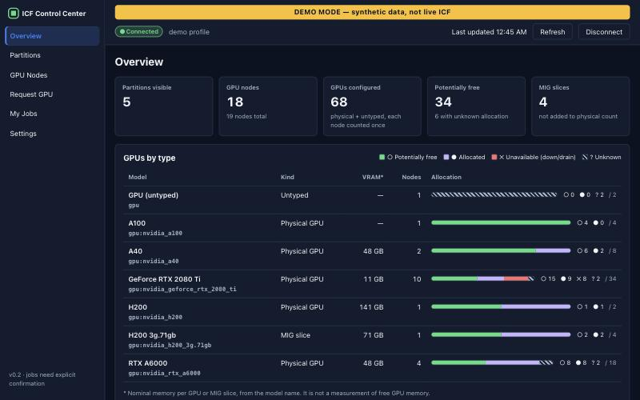
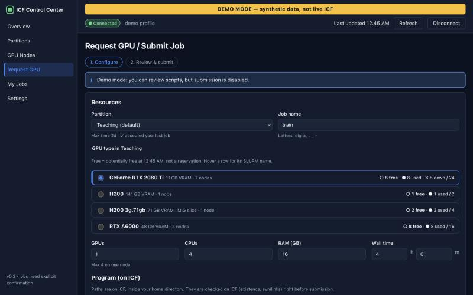
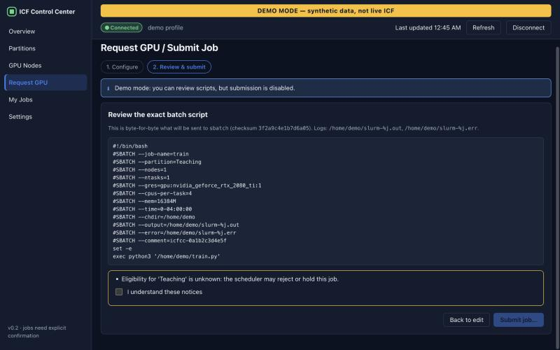
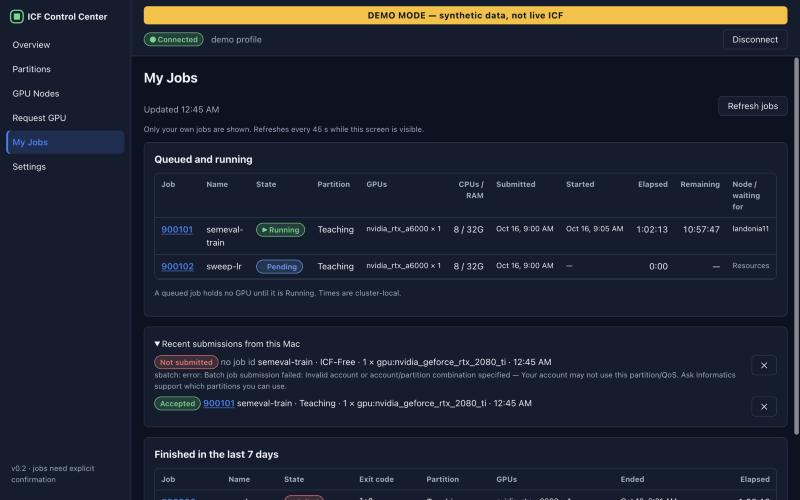
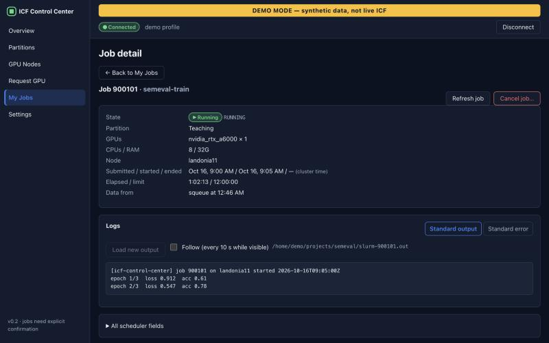
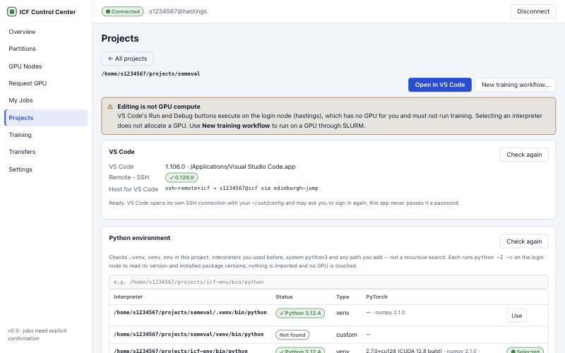
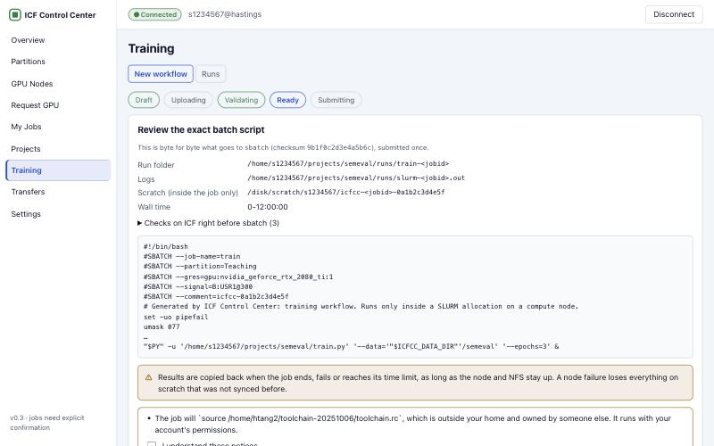
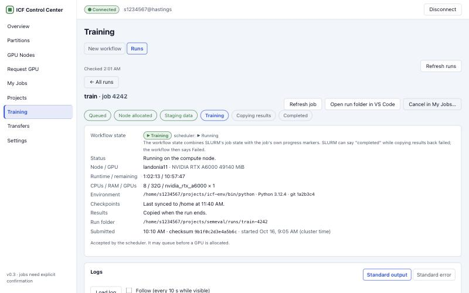
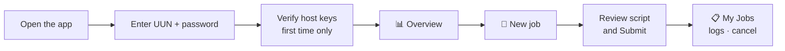
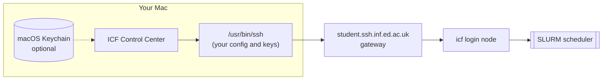

<div align="center">

# 🖥️ ICF Control Center

**A friendly macOS app for the University of Edinburgh Informatics Compute Facility (ICF) GPU cluster.**

See which GPUs are free, open your projects in VS Code, move datasets, run training on GPU nodes with
scratch staging and checkpoints, and follow everything — without remembering a single `sinfo`,
`sbatch` or `squeue` flag.


[**⬇️ Download**](https://github.com/CemSarp/ICF-GUI/releases/latest) ·
[User guide](docs/USER_GUIDE.md) ·
[Security](docs/SECURITY.md) ·
[Changelog](docs/CHANGELOG.md)



</div>

---

## ✨ What is it for?

Training a model on ICF usually means: SSH through the gateway, run `sinfo`/`scontrol` to guess which
GPUs are free, hand-write an `sbatch` script, then keep running `squeue` and `tail` to see if it
worked. **ICF Control Center puts all of that in one window.**

| | |
|---|---|
| 📊 **See the cluster** | Every partition and GPU node, with **free / used / down** GPUs per type (RTX 2080 Ti, A6000, H200, MIG slices…), refreshed once a minute. |
| 🚀 **Request a GPU** | A short form: pick a partition and GPU type, CPUs, RAM, time and your script. The app writes the `sbatch` script for you and shows it **before** anything is sent. |
| 📋 **My Jobs** | Your queued, running and finished jobs, with why a job is waiting, exit codes and hints (timeout, out of memory…). |
| 📜 **Live logs** | Read your job's output and errors in the app, and follow them while it runs. |
| 🛑 **Cancel safely** | Cancel your own jobs, with a confirmation. Other people's jobs can't be touched. |
| 🗂️ **Projects + VS Code** | Browse your ICF home, open a project in VS Code over Remote - SSH, pick the remote Python interpreter and CUDA toolchain. |
| ⇅ **Transfers** | Upload datasets and download results over your existing SSH connection, verified with SHA-256, resumable, never overwriting. |
| 🏋️ **Training workflows** | One reviewed job that stages data to the GPU node's fast local disk, trains, saves checkpoints, copies results back and cleans up. |
| 📈 **Runs** | Follow each run's stage, node, GPU, checkpoints, results and failures — even after restarting the app. |
| 🔐 **Safe by design** | Uses your Mac's own `ssh`. Passwords never touch disk unless you opt in to the macOS Keychain. Nothing is ever submitted without your explicit click. |

## 🖼️ A quick tour

| Request a GPU | Review the exact script |
|---|---|
|  |  |
| **My Jobs** | **Job detail and logs** |
|  |  |

| **Project + VS Code + Python env** | **Training workflow review** |
|  |  |
| **Run detail** | |
|  | |

*Screenshots use synthetic demo data, not a real account.*

## ⬇️ Install

1. Download the latest **`ICF-Control-Center-<version>-macOS-arm64.zip`** from the
   [latest release](https://github.com/CemSarp/ICF-GUI/releases/latest) and unzip it.
2. Drag **ICF Control Center.app** into your **Applications** folder.
3. The first time, macOS will warn you because the app isn't notarized by Apple. Open it once anyway:
   - **System Settings → Privacy & Security → "Open Anyway"**, or
   - in Terminal: `xattr -dr com.apple.quarantine "/Applications/ICF Control Center.app"`

Requires an Apple Silicon Mac (M1 or newer) with macOS 13 or later, and an Informatics (DICE) account
with ICF access.

## 🚀 Quick start



1. **Sign in.** Choose **Username and password**, type your UUN (e.g. `s1234567`) and your DICE
   password. Tick *Use the same password for the gateway and ICF* if they're the same.
   **No SSH setup is needed:** if your Mac has no `icf` entry in `~/.ssh/config`, the app goes through
   `student.ssh.inf.ed.ac.uk` for you. Already use SSH keys? Choose **Use existing SSH config / agent**.
2. **Check the host keys** the first time. The app shows each server's fingerprint; compare it with
   the one Informatics publishes before accepting.
3. **Look around.** *Overview* shows GPUs by type, *Partitions* and *GPU Nodes* show the details.
4. **Request a GPU.** Pick a partition (normally **Teaching**) and a GPU type, then set CPUs, RAM and
   wall time. Give the working directory (relative paths start in your home, e.g. `projects/myrun`) and
   your script (`train.py`, or a bash script).
5. **Review and submit.** The app shows the exact batch script. Tick the notices, click
   **Submit job…**, then confirm. The job is submitted **exactly once**.
6. **Follow it** in **My Jobs**: open the job, load its log, and cancel it if you need to.

7. **Train with your data (V3).** In **Projects**, open your project folder, pick its Python
   environment and *Open in VS Code* to edit. Upload a dataset archive in **Transfers**, then
   **New job → Training workflow**: the job copies the archive to the GPU node's local scratch disk, trains,
   syncs checkpoints to `/home` and copies results back. Follow it in **Runs**.

👉 The full walkthrough, including what each node state means, is in the [user guide](docs/USER_GUIDE.md).
Want to look around first? Click **Explore demo data** on the login screen.

## 🔐 How it connects (and why it's safe)



- Uses **your Mac's OpenSSH** with normal host-key checking, never `sshpass` or "accept any key".
- Passwords travel only through a private, in-memory channel to `ssh`. They're never put in command
  lines, environment variables, logs or files, and go into the Keychain only if you tick *Remember*.
- The interface can't run arbitrary commands, only fixed, typed operations: read-only SLURM queries,
  `sbatch`/`scancel` after your confirmation, and (V3) bounded folder listings, SFTP transfers and
  explicit file writes that never overwrite.
- VS Code makes its own SSH connection; the app never hands it your password and never edits
  `~/.ssh/config`.
- It's gentle on the cluster: one small query a minute while the window is visible, nothing while
  it's minimised, and the connection closes after 30 minutes of inactivity.

Details: [docs/SECURITY.md](docs/SECURITY.md).

## ⚠️ Good to know

- **"Free" means potentially free.** Counts come from SLURM's allocation, not from GPU utilisation.
  The scheduler decides when a job actually starts.
- **Times** are shown as SLURM reports them (cluster-local, UK time).
- **VRAM** figures are nominal per GPU model, not live free memory.
- The app never uses `srun`/`salloc` or keeps an interactive GPU shell open. Interactive Jupyter is
  off; notebooks run as batch jobs.
- **Scratch is temporary and `/home` is not backed up.** Results reach `/home` when a job ends, fails,
  is cancelled or nears its time limit — but nothing can be copied from a node that fails. Use the
  periodic checkpoint sync and keep your own copies of important results.

## 👋 About

ICF Control Center is a personal project by **Cem Sarp Takim**, a student at the University of
Edinburgh. It started from wanting a calmer way to work with the ICF GPU cluster. It is **not an
official Informatics tool** and isn't endorsed by the School of Informatics. Please follow the ICF
usage rules, and contact Informatics computing support for account or cluster issues.

Feedback and bug reports are welcome via [GitHub issues](https://github.com/CemSarp/ICF-GUI/issues).

<details>
<summary><b>🛠️ For developers: build, run and test</b></summary>

### Prerequisites (Apple Silicon, macOS 13+)

| Tool | Why | Check |
|---|---|---|
| Xcode Command Line Tools | Rust linker, macOS SDK | `xcode-select -p` |
| Rust ≥ 1.82 (`brew install rust` or rustup) | Tauri backend | `cargo --version` |
| Node 20+ and pnpm 10 | frontend build | `node -v && pnpm -v` |
| macOS OpenSSH (`/usr/bin/ssh`) | all cluster access | `ssh -V` |

### Repository layout

| Folder | What lives there |
|---|---|
| [`frontend/`](frontend) | React + TypeScript UI (Vite). `src/` app code, `tests/` Vitest suite, `dev/` browser preview with a mocked backend, `fixtures/` demo data the UI tests load |
| [`backend/`](backend) | Rust/Tauri app: SSH, SLURM, jobs, transfers, workflows. `src/` app logic, `tests/` integration tests, `capabilities/` IPC grants, `fixtures/` demo inventory, `icons/` |
| [`docs/`](docs) | User guide, architecture, security, decisions, testing, changelog, smoke-test examples |

The UI never runs commands itself; it calls typed Tauri commands (`frontend/src/lib/api.ts`), and the
backend runs every SSH and SLURM command.

### Run and build

All `pnpm` commands run from `frontend/`; all `cargo` commands from `backend/`.

```bash
cd frontend
pnpm install
```

```bash
pnpm tauri dev
```

```bash
pnpm tauri build
```

The `.app` lands in `backend/target/release/bundle/macos/`. It's ad-hoc signed (not notarized).
For UI work without SSH, run `pnpm dev` and open <http://localhost:1420/dev/preview.html?state=demo>
(or `?state=live` for the V3 screens with synthetic data).

### Tests

```bash
pnpm lint && pnpm typecheck && pnpm test && pnpm build
```

```bash
cd backend && cargo fmt --check && cargo clippy --all-targets -- -D warnings && cargo test
```

Opt-in tests that touch local machine state (never the cluster):

```bash
cd backend && cargo test --test real_openssh -- --ignored
```

```bash
cd backend && cargo test --lib keychain_roundtrip -- --ignored
```

Automated tests never contact ICF or submit real jobs; scheduler commands run against a scripted ssh and
stub `sbatch`/`squeue`/`scancel`.

### Project docs

[Architecture](docs/ARCHITECTURE.md) · [Security](docs/SECURITY.md) · [Decisions](docs/DECISIONS.md) ·
[Cluster compatibility](docs/CLUSTER_COMPATIBILITY.md) · [Testing](docs/TESTING.md) ·
[Release checklist](docs/RELEASE_CHECKLIST.md) · [Changelog](docs/CHANGELOG.md)

</details>
